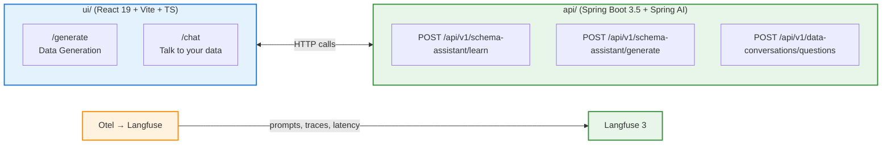
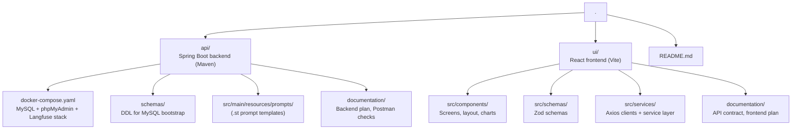

<div align="center">

# Data Assistant

**Synthetic data generation and conversational analytics over your own SQL schema.**

`Data Assistant` turns a DDL schema into realistic synthetic data, lets you refine it with natural-language
instructions, and then lets you *talk to that data* — asking questions in plain English and getting answers back as
text, tables, and charts.

[](https://openjdk.org/)
[](https://spring.io/projects/spring-boot)
[](https://react.dev/)
[](https://www.typescriptlang.org/)
[](https://www.mysql.com/)
[](https://langfuse.com/)

</div>

---

## The problem

Teams prototyping a product rarely have realistic data — and the data they *do* have rarely looks like production
data. Meanwhile, business questions still get answered by a human writing SQL.

This project closes both gaps with one pipeline:

1. **Learn** — upload a SQL schema. The backend normalizes the DDL into a structured model (tables, columns, types,
   keys, comments) using an LLM, with the result cached per conversation.
2. **Generate** — ask for rows in plain language ("10 authors from Spain"). The backend produces valid synthetic data
   that respects the schema's constraints, primary keys and foreign keys. The frontend packages the result into a
   downloadable ZIP of CSVs.
3. **Talk** — switch to the *Talk to your data* tab and ask questions about the schema. The backend converts the
   question to SQL (with a safety valve for "cannot answer this"), executes it against the live schema, and returns
   rows plus metadata. The frontend renders the answer as prose, a sortable table, and bar/pie/line charts.

## Architecture



Every LLM call is observed through Micrometer and exported over OTLP to **Langfuse**, so prompts, completions and
latency are traceable per conversation.

## Tech stack

| Layer | Technology |
| --- | --- |
| Frontend | React 19, TypeScript 5.9, Vite 7, React Router 7, TanStack Query 5, React Hook Form, Zod, Recharts, Pico CSS, JSZip, Axios |
| Backend | Java 21, Spring Boot 3.5, Spring AI 1.0 (Vertex AI / Gemini 2.5 Flash), Liquibase, Spring Cache, Maven |
| Observability | Micrometer + OpenTelemetry OTLP → Langfuse 3 (Prompts, traces, latency) |
| Data | MySQL 8.4 (LTS, image pinned in `api/docker-compose.yaml`), phpMyAdmin for schema inspection |
| Local infra | Docker Compose — MySQL, phpMyAdmin, Langfuse (web, worker, Postgres, ClickHouse, MinIO, Redis) |
| Testing | JUnit 5 + Mockito (unit), Maven Failsafe (integration) |

## Repository layout



This repository was consolidated from two separate repositories (`…-api` and `…-ui`); their full commit history is
preserved, so `git log -- api/` and `git log -- ui/` still walk the original timelines.

## Getting started

### 1. Infrastructure (MySQL + Langfuse)

```bash
cd api
docker compose up -d
```

- MySQL → `localhost:3306` (root password `1234`), phpMyAdmin → <http://localhost:8090>
- Langfuse → <http://localhost:3001>

### 2. Backend

```bash
cd api
export GOOGLE_CLOUD_PROJECT=<your-gcp-project>
export GOOGLE_CLOUD_LOCATION=us-central1
export LANGFUSE_OTEL_AUTH=<base64 of "pk-…:sk-…">   # Langfuse project API keys
./mvnw spring-boot:run
```

The API serves on <http://localhost:8081>.

### 3. Frontend

```bash
cd ui
npm install
npm run dev
```

The UI serves on <http://localhost:5173> and talks to the API at `http://localhost:8081`
(configured in `ui/src/services/httpClient.ts`).

### Tests

```bash
cd api && ./mvnw verify      # unit + integration (Failsafe) — needs MySQL up and GCP credentials
cd ui  && npm run build      # type-check + bundle (there is no UI test runner yet)
```

Known issues in both projects are tracked in [`api/CLAUDE.md`](api/CLAUDE.md) and [`ui/CLAUDE.md`](ui/CLAUDE.md).

## API surface

| Method | Endpoint | Purpose |
| --- | --- | --- |
| `POST` | `/api/v1/schema-assistant/learn` | Normalize an uploaded DDL schema into a structured model (multipart). |
| `POST` | `/api/v1/schema-assistant/generate` | Generate synthetic rows for a learned schema, driven by natural-language instructions. |
| `POST` | `/api/v1/data-conversations/questions` | Answer a question over the schema: NL → SQL → executed result, with metadata for charting. |

Full request/response shapes live in [`ui/documentation/api-contract.md`](ui/documentation/api-contract.md); the
Postman collection notes are in `api/documentation/postman-tests.md`.

## Design notes

- **Responses are validated at the boundary.** Every payload the UI receives is parsed with a Zod schema; anything
  that does not match is rejected rather than rendered.
- **The DDL is cached, the data is not.** Schema learning is `@Cacheable` per `(conversationId, schemaName, prompt)`;
  generated rows are intentionally not persisted by default.
- **Prompts live in resources, not in code.** `.st` templates under `api/src/main/resources/prompts/` keep the
  NL → SQL and schema → JSON instructions editable without touching Java.

## Demo

Screen recordings of both flows are kept in the working copy of this repository (`01-data-generation.mov`,
`02-talk-to-you-data.mov`). They are excluded from git because of their size (~165 MB).

---

*Practice project — synthetic data generation and conversational analytics, built with Spring AI, React and Langfuse.*
